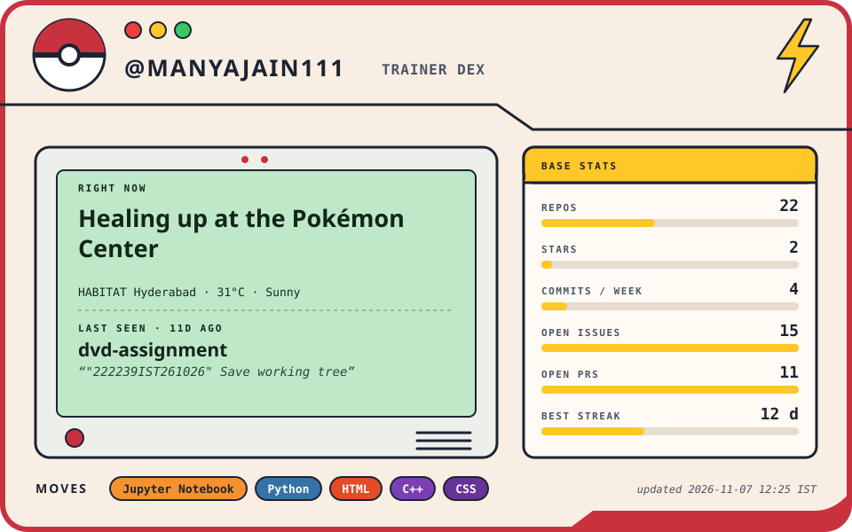

<!--
```json
{
  "status": "Healing up at the Pokémon Center",
  "weather": {
    "location": "Hyderabad",
    "temperature": "31°C",
    "condition": "Sunny"
  },
  "github": {
    "top_languages": [
      "Jupyter Notebook",
      "Python",
      "HTML",
      "C++",
      "CSS"
    ],
    "latest_active_repo": "dvd-assignment",
    "last_commit": "2026-10-26T16:52:39Z",
    "last_commit_message": "\"222239IST261026\" Save working tree",
    "current_streak": 6,
    "longest_streak": 12,
    "commits_last_7_days": 4,
    "open_issues": 15,
    "open_prs": 11,
    "total_repos": 22,
    "total_stars": 2,
    "most_starred_repo": {
      "name": "green-banking-intelligence",
      "stars": 1
    }
  },
  "updated": "2026-11-07 12:25 IST"
}
```
-->
